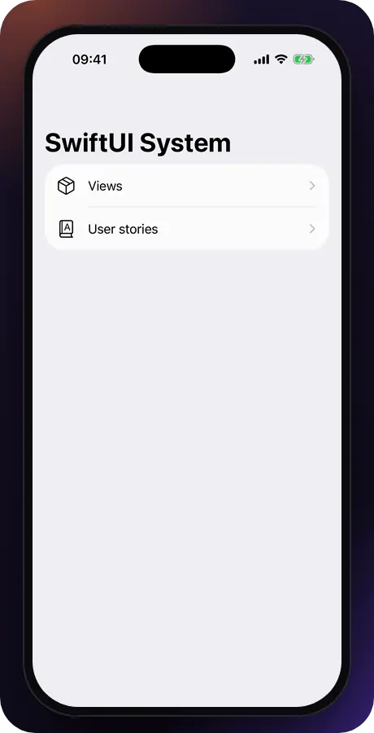
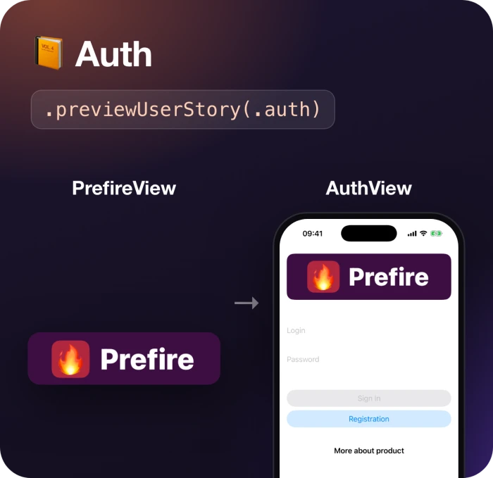
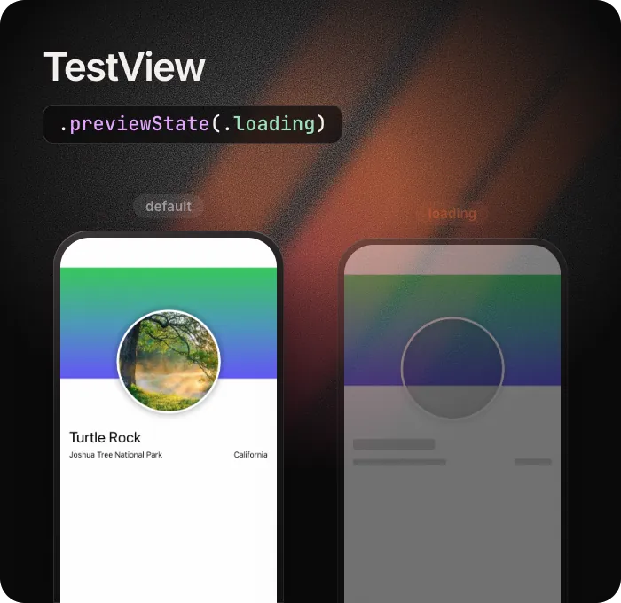

<p align="center">
  <picture>
    <source media="(prefers-color-scheme: dark)" srcset="Documentation/Images/hero-dark.svg">
    
  </picture>
</p>

<p align="center">
<a href="https://github.com/BarredEwe/Prefire/releases/latest"></a>
<a href="https://github.com/BarredEwe/Prefire/stargazers"></a>
<a href="https://developer.apple.com/"></a>
<a href="https://developer.apple.com/swift"></a>
<a href="https://swift.org/package-manager"></a>

</p>

<p align="center">
  <a href="#-quick-start"><b>Quick Start</b></a> ·
  <a href="#-installation"><b>Installation</b></a> ·
  <a href="#-usage"><b>Usage</b></a> ·
  <a href="#-let-ai-agents-see-swiftui"><b>AI agents</b></a> ·
  <a href="#-configuration-prefireyml"><b>Configuration</b></a> ·
  <a href="Documentation"><b>Docs</b></a>
</p>

## 🔥 What is Prefire?

**Prefire** turns the `#Preview` blocks you already write into tests, a catalog and images, with no extra code.

<table>
  <tr>
    <td width="33%" valign="top">
      <h3>📸 Snapshot tests</h3>
      Every preview becomes a snapshot test, on the devices you pick. Catch visual regressions before users do.
      <br><br><a href="#snapshot-tests">How it works →</a>
    </td>
    <td width="33%" valign="top">
      <h3>📚 Playbook</h3>
      An interactive catalog of your components and user stories, with states and render times. Living documentation.
      <br><br><a href="#playbook-demo-view">See Playbook →</a>
    </td>
    <td width="33%" valign="top">
      <h3>🤖 AI-ready renders</h3>
      Claude Code, Cursor and Codex render your previews through an MCP server, on any iPhone or iPad, light or dark.
      <br><br><a href="#-let-ai-agents-see-swiftui">Set up →</a>
    </td>
  </tr>
</table>

> 🤖 **Using an AI agent?** `brew install barredewe/prefire/prefire`, then `claude mcp add prefire -- prefire mcp` in your project. The agent renders SwiftUI previews on any iPhone or iPad, light or dark, without Xcode Previews. [Setup →](Documentation/AI.md)

## 🚀 Key Features



- 🧠 **Smart Preview Parsing** — including `#Preview`, `@Previewable`
- 📸 **Snapshot Testing** — automatic test generation from previews (iOS, tvOS, macOS)
- 📚 **Playbook View** — auto-generated interactive component catalog (iOS)
- 🏃 **Flow-aware** — build user stories from multiple preview steps
- 🤖 **AI-ready** — render previews to PNG for agents with `prefire render` and an [MCP server](Documentation/AI.md)
- 🧩 **UIKit + AppKit Support** — support for `UIView`/`UIViewController` and `NSView`/`NSViewController`
- ⚙️ **SPM + Xcode Plugins** — works in CLI, Xcode build phases, or CI
- 🧠 **Fast Caching** — fingerprint-based AST and body caching avoids redundant work
- ✍️ **Stencil Templates** — customize output with [your own templates](Documentation/Templates.md)

### Why Prefire? 

- 🔥 **Save Time** - Generate tests and documentation automatically
- 🔥 **Stay Consistent** - Keep previews and tests always in sync
- 🔥 **Improve Quality** - Catch visual regressions before users do
- 🔥 **Boost Collaboration** - Share living documentation with your team

<br clear="all">

---
## ⚡ Quick Start

> 📦 Example project available at: [Prefire Example](https://github.com/BarredEwe/Prefire/tree/main/Example)

### 1. Add Prefire to Your Project

```swift
// Package.swift
dependencies: [
    .package(url: "https://github.com/BarredEwe/Prefire.git", from: "6.3.0"),
    .package(url: "https://github.com/pointfreeco/swift-snapshot-testing", from: "1.18.0"),
],
.testTarget(
    dependencies: [
      .product(name: "Prefire", package: "Prefire"),
      .product(name: "SnapshotTesting", package: "swift-snapshot-testing"),
    ],
    plugins: [
        .plugin(name: "PrefireTestsPlugin", package: "Prefire")
    ]
)
```

### 2. Write `#Preview`

```swift
#Preview {
    Button("Submit")
}
```

### 3. Run tests

Just run the test target 🚀 — Prefire will auto-generate snapshots based on your previews.

> 💡 If your test target is empty, Prefire will still generate files and snapshot code during build.


---

## 📦 Installation

| Method | How |
|--------|-----|
| SPM Plugin | `PrefireTestsPlugin` / `PrefirePlaybookPlugin` in `Package.swift` |
| Xcode Build Tool Plugin | Add `PrefireTestsPlugin` to the test target's build phases |
| CLI | `brew install barredewe/prefire/prefire` |
| Mint (*Beta*) | `mint install BarredEwe/Prefire` |
| GitHub Actions / CI | Any of the above, see [Troubleshooting](#-troubleshooting) |

Step-by-step setup is in the [Installation guide](Documentation/Installation.md).

### Requirements

- Swift 6.0 or higher
- Xcode 16.0 or higher
- iOS 14 or higher; macOS 13 or higher (macOS: snapshot tests only, see [Configuration](Documentation/Configuration.md#macos-snapshot-tests))

---

## 🛠 Usage

### Choose previews

Prefire finds every **`#Preview`** automatically. For `PreviewProvider`, add the `PrefireProvider` protocol:

```swift
struct Text_Previews: PreviewProvider, PrefireProvider {
    static var previews: some View { ... }
}
```

Exclude a preview with `.prefireIgnored()`:

```swift
#Preview {
    Text("")
        .prefireIgnored()
}
```

To opt in instead of opting out, set `preview_default_enabled: false` in [`.prefire.yml`](#-configuration-prefireyml) and mark the previews you want with `.prefireEnabled()`:

```swift
#Preview {
    Text("")
        .prefireEnabled()
}
```

### Snapshot tests

`PrefireTestsPlugin` generates the tests into the DerivedData folder when the test target builds. Run the test target as usual.

Tune the timing and precision of a single snapshot:

```swift
#Preview {
    TestView()
        .snapshot(delay: 0.3, precision: 0.95, perceptualPrecision: 0.98)
}
```

For previews that load or animate, wait instead of guessing a delay:

```swift
.snapshot(waitForIdle: true)                     // until nothing changes on screen
.snapshot(waitUntil: { viewModel.isLoaded })     // until a condition is true
```

How waiting works, its limits and how the modifiers combine: [Snapshot timing and precision](Documentation/Snapshots.md).

Snapshots are compared with [swift-snapshot-testing](https://github.com/pointfreeco/swift-snapshot-testing).

### Playbook (Demo) View

Show all previews as an interactive catalog with `PlaybookView`:

- `isComponent: true` lists all the Views
- `isComponent: false` groups them by UserStory

```swift
import Prefire 

struct ContentView: View {
    var body: some View {
        PlaybookView(isComponent: true, previewModels: PreviewModels.models)
    }
}
```

To keep previews and `PreviewModels` out of release builds, see [Excluding previews from release builds](Documentation/Installation.md#excluding-previews-from-release-builds).

### Flows



Connect previews into one **Flow** with `.previewUserStory`. Playbook shows them together, in order:

```swift
static var previews: some View {
    PrefireView()
        .previewUserStory(.auth)
}

static var previews: some View {
    AuthView()
        .previewUserStory(.auth)
}
```

<br clear="all">

### States



If a preview contains more than one `View`, mark the `State` of each:

```swift
static var previews: some View {
    TestView("Default")

    TestView("Loading")
        .previewState(.loading)
}
```

<br clear="all">

### Parameterized previews

Prefire expands each argument of a native SwiftUI parameterized preview into its own snapshot and Playbook preview:

```swift
#Preview("TextView", traits: .sizeThatFitsLayout, arguments: ["- A", "- B", "- C"]) { suffix in
    Text("1 \(suffix)")
}
```

---

## 🧰 API

| Feature | Modifier |
|--------|----------|
| Include in snapshot | `.prefireEnabled()` |
| Exclude from snapshot | `.prefireIgnored()` |
| Group in a flow | `.previewUserStory(.auth)` |
| Mark a UI state | `.previewState(.error)` |
| Customize snapshot | `.snapshot(delay: 0.3, precision: 0.95)` |
| Wait until the preview settles | `.snapshot(waitForIdle: true, timeout: 2.0)` |
| Wait for a condition | `.snapshot(waitUntil: { viewModel.isLoaded })` |
| Parameterized preview | `#Preview(..., arguments: values)` |

---

## 💡 CLI Usage

```bash
# Generate snapshot tests
prefire tests

# Generate playbook models
prefire playbook
```

Run `prefire tests --help` or `prefire playbook --help` for more options.

---

## 🤖 Let AI agents see SwiftUI

Prefire renders previews in its snapshot tests, built anew and on the devices you choose, so it can
show them to an AI agent as images, which Xcode Previews can't do reliably outside Xcode.

```bash
# Render previews to PNG + JSON
prefire render "Sign in" --device "iPhone 16 Pro" --color-scheme dark

# An HTML board of the last render, grouped by user story
prefire board
```

Add the MCP server to your agent, from the folder with `.prefire.yml`:

| Agent | Install |
| --- | --- |
| Claude Code | `claude mcp add prefire -- prefire mcp`, or the plugin with a skill: `/plugin marketplace add BarredEwe/Prefire` then `/plugin install prefire@prefire` |
| Cursor | [](https://cursor.com/en/install-mcp?name=prefire&config=eyJjb21tYW5kIjoicHJlZmlyZSIsImFyZ3MiOlsibWNwIl19) |
| Codex | `codex mcp add prefire -- prefire mcp` |
| VS Code | `code --add-mcp '{"name":"prefire","command":"prefire","args":["mcp"]}'` |

An agent then calls `list_previews`, `render_previews` and `build_board`. Set the scheme to build in
`render_configuration` of `.prefire.yml`; see the [AI guide](Documentation/AI.md). Why not Xcode's own
`RenderPreview`? Prefire needs no running Xcode, renders many previews in one build, on the devices,
color scheme and Dynamic Type you ask for, and works in CI.

---

## 🗂 Configuration: `.prefire.yml`

```yaml
test_configuration:
  target: MyApp

playbook_configuration:
  preview_default_enabled: true
```

All options are in the [Configuration guide](Documentation/Configuration.md). To change the generated code, see [Templates](Documentation/Templates.md).

---

## 🧠 How It Works

1. 🔍 **Parses all source files** — finds `#Preview` and `PreviewProvider` blocks and the `.prefireEnabled()` / `.prefireIgnored()` modifiers
2. 📂 **Caches `Types` and `PreviewBodies`** — keyed by file modification date + SHA-256 of inputs, so nothing is re-parsed if nothing changed
3. 🔢 **Generates snapshot tests** — from `Stencil` templates, respecting `.prefire.yml`
4. 📘 **Generates Playbook models** — groups by `UserStory` and `State` into `PreviewModels.generated.swift`

---

## 🩺 Troubleshooting

| Problem | Fix |
|---------|-----|
| `NavigationView` in a preview doesn't work in Playbook | Use other views or layouts for your Playbook needs |
| Plugins don't run on CI | `defaults write com.apple.dt.Xcode IDESkipPackagePluginFingerprintValidatation -bool YES` |
| Xcode can't generate tests in a custom path | Disable the plugin sandbox: `defaults write com.apple.dt.Xcode IDEPackageSupportDisablePluginExecutionSandbox -bool YES` |

---

## 🐱 Also by the author


[**Mewmori**](https://mewmori.com/?src=prefire) is a pixel cat that lives on your Mac desktop.
He reads what's on screen, says something about it, and remembers you between sessions.
A 2B model runs on the machine through llama.cpp, so screen text, chats and memory stay on your Mac.

Swift, AppKit + SwiftUI, 29 MB. Free; only skins are paid.

<br clear="all">

## 🤝 Contributing

We welcome contributions! Development setup, tests and the internal architecture are described in [CONTRIBUTING.md](CONTRIBUTING.md).

## ⭐ Star history

If Prefire saves you time, give it a star: it helps other iOS developers find it.

<a href="https://star-history.com/#BarredEwe/Prefire&Date">
  <picture>
    <source media="(prefers-color-scheme: dark)" srcset="https://api.star-history.com/svg?repos=BarredEwe/Prefire&type=Date&theme=dark">
    
  </picture>
</a>

## 📄 License
Prefire is released under the Apache License 2.0. See [LICENSE](https://github.com/BarredEwe/Prefire/blob/main/LICENSE) for details.
